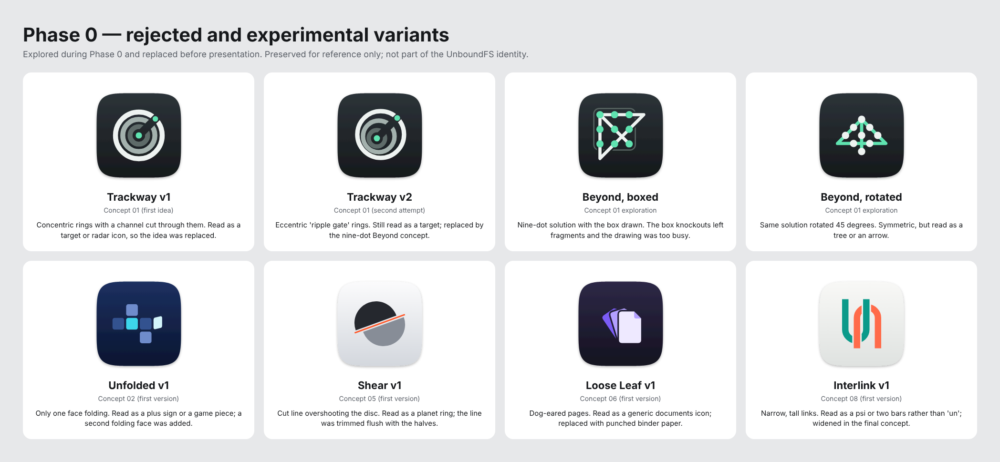

# Rejected and experimental variants

Variants explored during Phase 0 and replaced before the eight concepts were presented.
They were never committed at the time; [`rejected_variants.py`](rejected_variants.py) reconstructs them
from the exact geometry used during the session. Each folder has `app-icon.svg` and `symbol.svg`.

| Variant | Why it was replaced |
|---|---|
| `01-trackway-v1`, `01-trackway-v2` | Read as a target or radar icon; Concept 01 became Beyond |
| `01-beyond-boxed` | Box knockouts left fragments; too busy |
| `01-beyond-rotated` | Read as a tree or an arrow |
| `02-unfolded-v1` | Read as a plus sign or game piece |
| `05-shear-v1` | Cut line overshot the disc and read as a planet ring |
| `06-loose-leaf-v1` | Dog-eared pages read as a generic documents icon |
| `08-interlink-v1` | Too narrow to read as "un" |

Rebuild: `UNBOUND_FONT_DIR=/path/to/ttf python3 rejected_variants.py && node ../tools/render.mjs .build/jobs.json`
