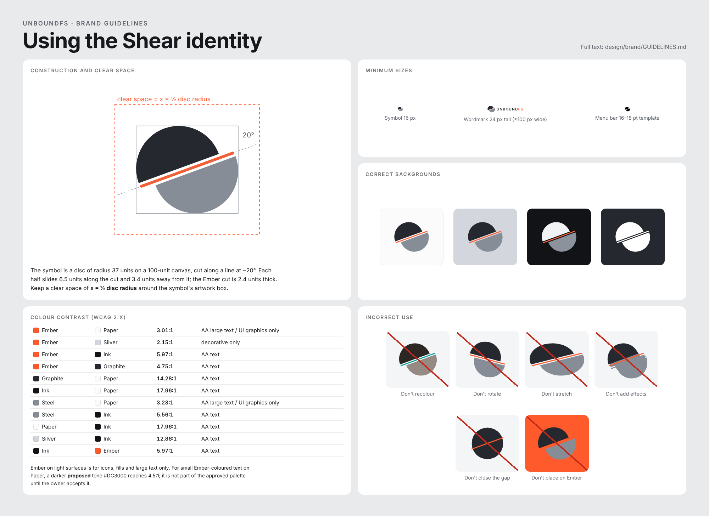

# UnboundFS brand guidelines

**Identity:** Shear (Silver & Ember), Concept 05 from Phase 0, selected by the project owner.
**Tagline:** *Storage without boundaries.*

## 1. The symbol

A storage disc split along a fault line, its two halves slipping past each other, with the boundary
itself exposed as an Ember line.

| Property | Value (100-unit canvas) |
|---|---|
| Disc radius | 37 |
| Fault line angle | −20° (rising to the right) |
| Slide along the fault line | 6.5 per half |
| Separation across the fault line | 3.4 per half |
| Ember cut thickness | 2.4, fully rounded ends, flush with both halves |
| Upper half / lower half / cut | Graphite `#25282E` / Steel `#878D97` / Ember `#FF5A2C` |
| Measured artwork box | x 5.7 – 94.3, y 12.0 – 88.0 |

The geometry is defined once, in [`tools/shear.py`](tools/shear.py), and is checked against the approved
Phase 0 artwork by [`tools/validate_brand.py`](tools/validate_brand.py). Never redraw the symbol by hand.

**Clear space:** keep at least **x = ½ disc radius** (18.5 units, one quarter of the disc's diameter)
free around the artwork box. No text, edges or other graphics inside that area.

**Minimum sizes:** symbol 16 px; wordmark lockup 24 px tall (about 100 px wide); menu bar glyph 16–18 pt.

## 2. Wordmark

The lockup sets **UNBOUNDFS** in **Inter SemiBold**, uppercase, tracking +0.12 em, with **FS** in Ember.
Cap height is 31 % of the symbol canvas; the lettering starts 12 units after the symbol canvas. The
lettering is outlined in every file, so no font is needed.

| File | Use |
|---|---|
| `wordmark/unboundfs-wordmark.svg` | Light backgrounds |
| `wordmark/unboundfs-wordmark-reversed.svg` | Dark backgrounds |
| `wordmark/unboundfs-wordmark-mono-black.svg` / `-mono-white.svg` | Single-colour reproduction |
| `wordmark/unboundfs-logotype*.svg` | Lettering only, where the symbol already appears nearby |

Write the name as **UnboundFS** in running text. The all-caps setting belongs to the logo only.

## 3. App icon

| File | Purpose |
|---|---|
| `app-icon/AppIcon.svg` | Master, 1024 × 1024 canvas, 824 px continuous-corner body, Paper → Silver gradient |
| `app-icon/AppIcon.icns` | macOS icon file (16–512 pt at 1× and 2×) |
| `app-icon/AppIcon.iconset/` | Source PNGs in `iconutil` naming |
| `app-icon/Assets.xcassets/AppIcon.appiconset/` | Drop-in Xcode asset catalog |
| `app-icon/AppIcon-small.svg` | Optical small-size variant used only for the 16 and 32 px rasters |
| `app-icon/AppIcon-dark.svg`, `AppIcon-tinted.svg` | Proposed macOS 26 dark and tinted appearance sources |
| `app-icon/icon-composer-layers/` | Upper half, lower half and Ember cut as separate layers on the 1024 canvas |

**Small-size optical variant.** At 16 and 32 px the 2.4-unit cut falls below one pixel and disappears.
These two sizes use a 4.4-unit cut and 4.6-unit separation. Shape, angle, proportions and colours are
unchanged. Every size from 64 px up uses the exact master.

**macOS 26 (Tahoe) Icon Composer.** macOS 26 introduces layered `.icon` files made with Apple's Icon
Composer, which add Liquid Glass rendering and the default, dark, clear and tinted appearances. Apps
built only with a classic `.icns` still work, but the system may draw them inside a standard plate. The
layers in `icon-composer-layers/` are prepared for that step. Assembling and checking the `.icon` file
needs Icon Composer on a Mac and has **not been done yet**; see "Open items" below.

## 4. Menu bar

`menubar/UnboundFSMenubarTemplate.svg` (plus 18 px and 36 px PNGs and an Xcode image set marked
*Render as Template*) is the Phase 0 simplified glyph: the two halves without the cut line, black only.
macOS tints template images for light, dark and highlighted menu bars automatically. Never colour the
menu bar glyph Ember.

## 5. Colour

| Name | HEX | Role |
|---|---|---|
| Ink | `#121316` | Darkest surface, text on light |
| Graphite | `#25282E` | Upper half, primary text on light |
| Steel | `#878D97` | Lower half, secondary graphics |
| Silver | `#D3D7DD` | Icon gradient end, neutral surfaces |
| Paper | `#FBFBFC` | Icon gradient start, light surfaces |
| Ember | `#FF5A2C` | Primary brand accent |

App icon background: `#FBFBFC` → `#D3D7DD` (top to bottom).
Reversed artwork tints (only inside the original dark-background logo files): `#F1F2F4`, `#8C929C`, `#FF6A3D`.

### Using Ember in the application

- Ember is the **brand accent**: selection highlights, the primary button, progress, the brand mark.
  Use it sparingly. A screen should feel native and neutral first.
- **Never use colour as the only signal.** Errors, warnings and success states use the system's
  semantic colours *and* an SF Symbol and a text label. Ember is not an error colour, and orange must
  not double as "warning" next to an Ember accent without an icon and label.
- Follow the system appearance (light, dark, increased contrast) and prefer system colours for text,
  backgrounds and separators.

### Contrast (WCAG 2.x)

| Foreground | Background | Ratio | Suitable for |
|---|---|---|---|
| Ember | Paper | 3.01:1 | Large text (≥ 18 pt, or 14 pt bold), icons, UI graphics |
| Ember | Silver | 2.15:1 | Decorative only |
| Ember | Ink | 5.97:1 | Text |
| Ember | Graphite | 4.75:1 | Text |
| Graphite | Paper | 14.28:1 | Text |
| Steel | Paper | 3.23:1 | Large text, UI graphics |
| Steel | Ink | 5.56:1 | Text |
| Ink | Ember | 5.97:1 | Text on Ember buttons |

On light surfaces Ember does **not** reach 4.5:1, so small Ember text needs a darker tone. The build
calculates `#DC3000` (same hue, 4.5:1 on Paper) as a **proposal only**. It is not part of the approved
palette until the owner accepts it. White text on Ember is 3.11:1 (large text only); use Ink text on Ember buttons for normal-size labels.

## 6. Typography

| Use | Typeface |
|---|---|
| Logo lettering | Inter SemiBold (outlined in the logo files) |
| Application UI | The system font (SF Pro / SF Pro Rounded where Apple uses it), via SwiftUI text styles |
| Website, README graphics, documentation images | Inter (SIL Open Font License 1.1) |

## 7. Incorrect use

Do not recolour, rotate, stretch, outline or add shadows or glows to the symbol. Do not close the gap,
move the halves, change the cut angle, or place the symbol on Ember. Do not re-set the wordmark in
another typeface or change its tracking. Do not use the seven unselected Phase 0 concepts for UnboundFS.

## 8. Open items

- Build and review the layered Icon Composer `.icon` file on macOS 26 and confirm the dark, clear and
  tinted appearances in the Dock and Finder.
- Check the final `.icns` with `iconutil` on macOS (it was assembled in CI-like Linux tooling and parsed
  successfully with Pillow).
- Owner decision on the proposed small-text Ember tone `#DC3000`.
