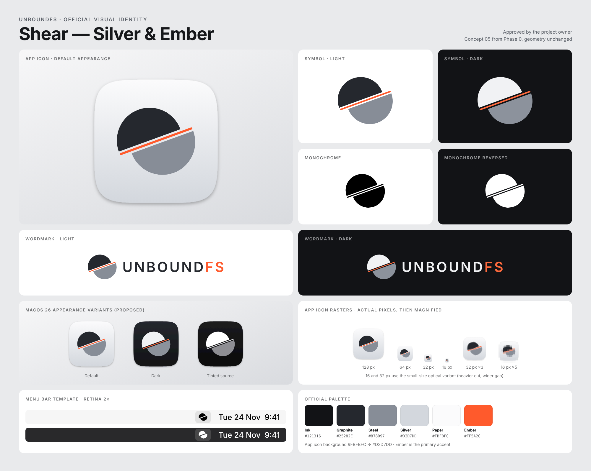
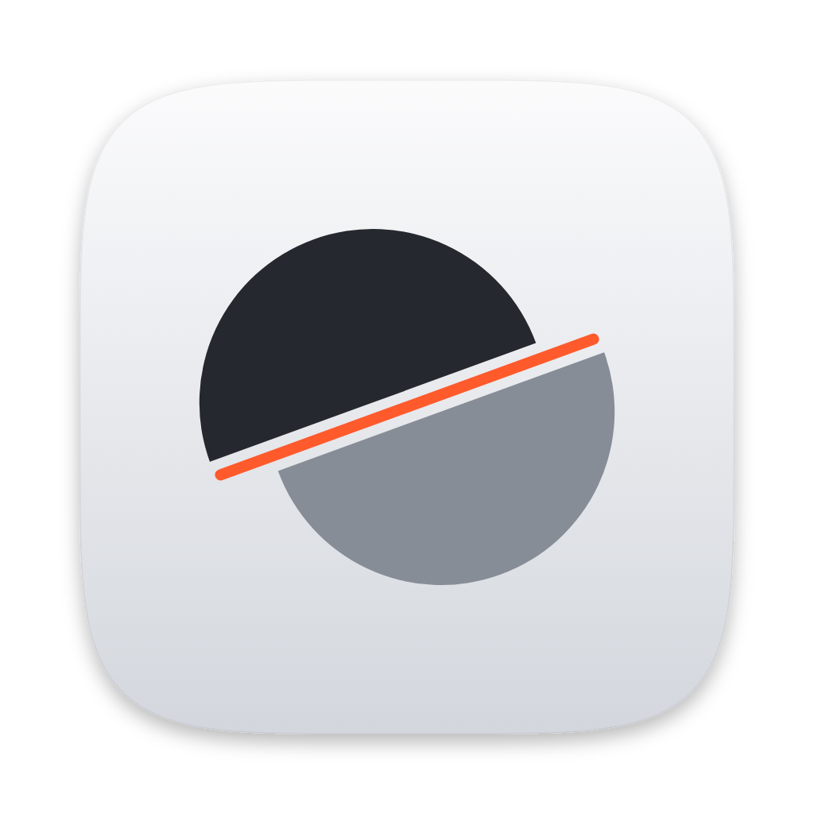
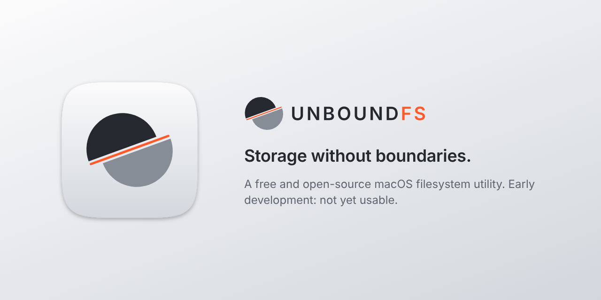

# UnboundFS brand assets

The official UnboundFS visual identity: **Shear (Silver & Ember)**, Concept 05 from Phase 0,
selected by the project owner. The geometry is unchanged from the approved concept.

**Start here:** [GUIDELINES.md](GUIDELINES.md) (colours, spacing, typography, correct use) ·
[guidelines board](previews/brand-guidelines.png)

## Downloads

| Folder | Contents |
|---|---|
| [`logo/`](logo/) | Symbol SVGs: colour, reversed, mono black, mono white; transparent PNGs (256–2048 px) |
| [`wordmark/`](wordmark/) | Symbol + lettering lockups and lettering-only logotypes; SVG and transparent PNG @2x/@4x |
| [`app-icon/`](app-icon/) | `AppIcon.svg` master, [`AppIcon.icns`](app-icon/AppIcon.icns), `AppIcon.iconset/`, Xcode `Assets.xcassets/AppIcon.appiconset/`, small-size variant, dark/tinted appearance sources, Icon Composer layers |
| [`menubar/`](menubar/) | Black-only template glyph: SVG, 18/36 px PNG, Xcode image set (*Render as Template*) |
| [`github/`](github/) | README banners (light/dark, 2560 × 640) and social preview (1280 × 640) |
| [`promo/`](promo/) | Hero images 2560 × 1440 (light, dark) and a 1080 × 1080 square |
| [`palette/`](palette/) | `palette.json`, `colors.css` |
| [`previews/`](previews/) | Overview and guidelines boards |
| [`tools/`](tools/) | Generator, renderer and validator ([README](tools/README.md)) |

| | |
|---|---|
|  |  |

## Release rules

- Only files from this folder may be used in the application, DMG, website or releases.
- The [design archive](../archive/) holds the other Phase 0 concepts for reference. It is excluded from
  source archives and must never be bundled.
- The GitHub social preview image is uploaded by hand: repository Settings → General → Social preview.
